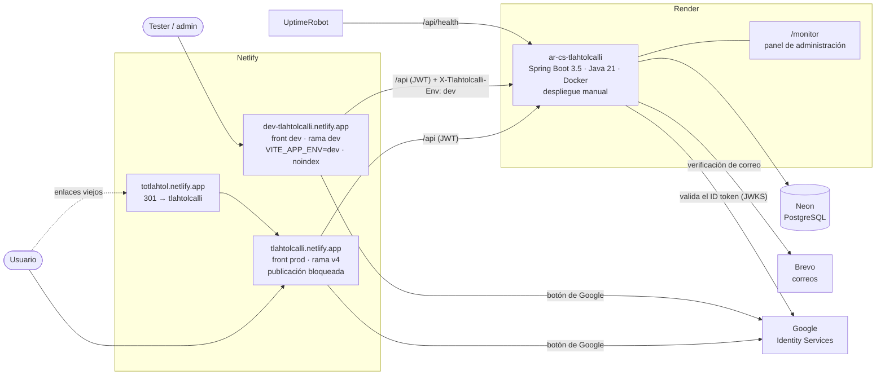
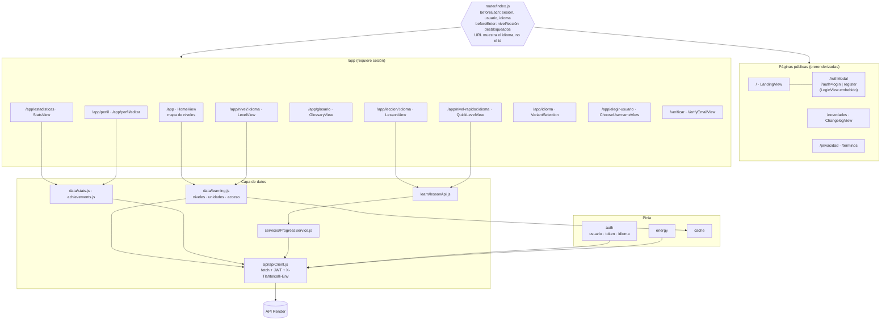
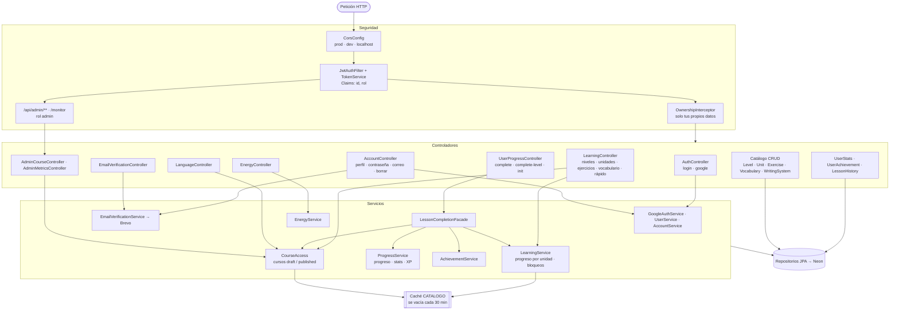
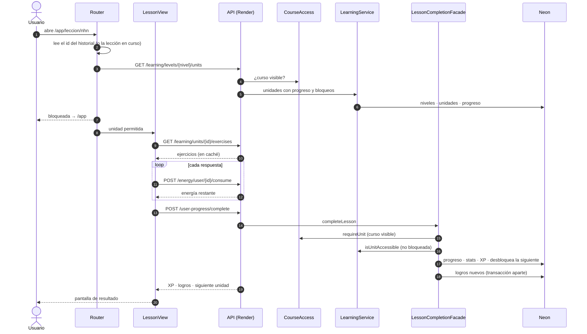
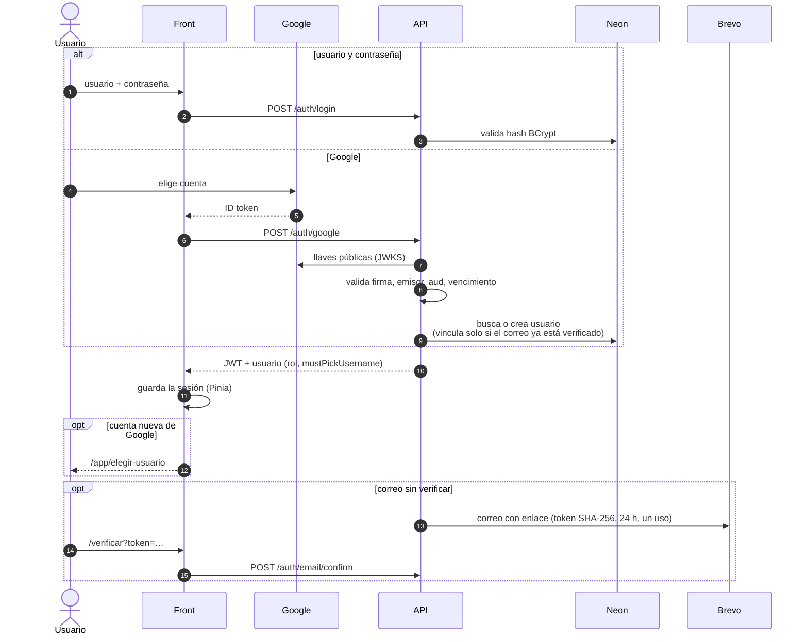
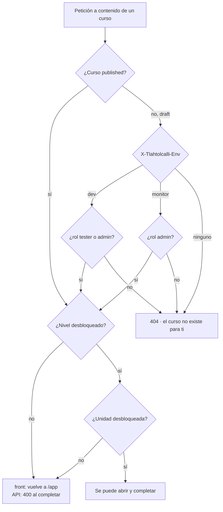
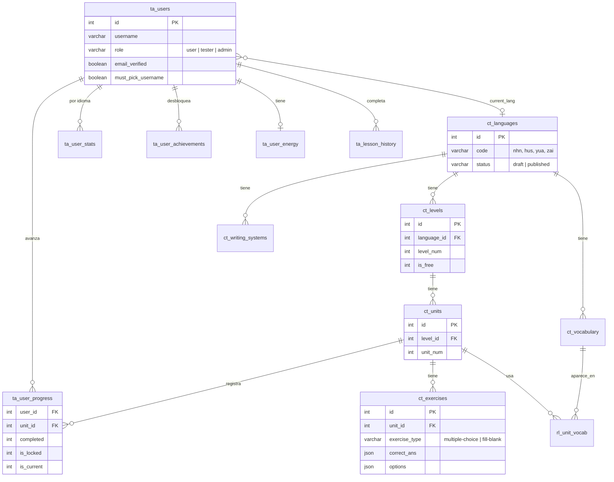

# Arquitectura de Tlahtolcalli

Diagramas hechos a mano a partir del código (versión 4.1). GitHub los dibuja directo (Mermaid).
**Actualízalos cuando cambie la estructura** (servicios nuevos, rutas, tablas, despliegue).

1. [Despliegue](#1-despliegue)
2. [Frontend](#2-frontend)
3. [Backend](#3-backend)
4. [Flujo de una lección](#4-flujo-de-una-lección)
5. [Inicio de sesión](#5-inicio-de-sesión)
6. [Reglas de acceso](#6-reglas-de-acceso)
7. [Modelo de datos](#7-modelo-de-datos)

---

## 1. Despliegue

| Pieza | Dónde | Variables clave |
|---|---|---|
| Front prod | Netlify `tlahtolcalli` | `VITE_API_URL`, `VITE_GOOGLE_CLIENT_ID` |
| Front dev | Netlify `dev-tlahtolcalli` | las mismas + `VITE_APP_ENV=dev` |
| API | Render `ar-cs-tlahtolcalli` | `DB_URL`, `DB_USERNAME`, `DB_PASSWORD`, `JWT_SECRET`, `GOOGLE_CLIENT_ID`, `BREVO_API_KEY`, `EMAIL_FROM`, `APP_URL`, `CORS_ORIGINS` |
| Monitor | Render (mismo servicio) | `NEON_API_KEY`, `RENDER_API_KEY`, `UPTIMEROBOT_API_KEY` |
| Base de datos | Neon | scripts en `b/.../static/sql_postgres` |

---

## 2. Frontend

Vue 3 + Pinia + Tailwind, en `f/`. Las páginas públicas se prerenderizan a HTML (SEO); el resto usa `spa.html`.

---

## 3. Backend

Spring Boot en `b/ar-cs-tlahtolcalli`. Capas: filtro de seguridad → controlador → servicio → repositorio (JPA) → Neon.

---

## 4. Flujo de una lección

---

## 5. Inicio de sesión

---

## 6. Reglas de acceso

- **Nivel 1** siempre abierto; el nivel N se abre al terminar el N-1 (o con el nivel rápido).
- **Unidad 1** abierta por defecto; las demás según `ta_user_progress.is_locked`.
- Un nivel bloqueado bloquea todas sus unidades.
- Publicar / regresar a pruebas: **Monitor → Idiomas**.

---

## 7. Modelo de datos

Tablas principales (prefijo `ct_` = catálogo, `ta_` = datos del usuario, `rl_` = relación).

